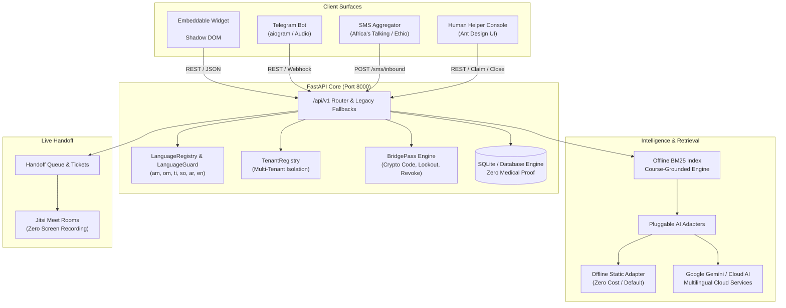

# Savanna Bridge Assistant — System Architecture

**ALX Digital Bridge Accessibility Hackathon 2026 — Track 3: Multilingual Assistant and Live Help**  
*Motto: "Your Language. Your Ability. Your Opportunity."*

---

## 1. High-Level Architecture Diagram



---

## 2. Core Architectural Pillars

### 2.1 The Front-End Widget (`widget/`)
- **Technology**: Vanilla TypeScript compiled via Vite into an ES2020 bundle.
- **Encapsulation**: Shadow DOM ensures zero CSS collisions with host stylesheets.
- **Custom Element Dual Tag**: Registered as `<bridge-assistant>` with `<db-assistant>` alias for cross-platform drop-in integration.
- **Accessibility Engine**:
  - Focus trapping and restoration (`aria-modal="true"`, `role="dialog"`).
  - ARIA Live regions for dynamic chat responses (`aria-live="polite"`).
  - Simple Language Mode: Shortens explanations, adds numbered steps, and explains technical jargon while preserving source links.
  - Native browser Web Speech API with fallback to MediaRecorder audio notes.

### 2.2 Grounded Retrieval Engine & Proof-of-Answer
- **Offline BM25 Retrieval**: Pre-indexes static course content (markdown, HTML, JSON).
- **Zero Hallucination Guarantee**: When BM25 similarity falls below confidence threshold ($\theta = 0.45$), the assistant generates a structured refusal:
  ```json
  {
    "answer": "I could not find reliable information about this in your course materials. Would you like to talk to a human mentor?",
    "citations": [],
    "confidence": 0.0,
    "reason": "low_confidence",
    "offer_human": true
  }
  ```
- **Deterministic Headings**: Every citation maps to real document anchors (`#section-name`), allowing screen-reader users and visual learners to jump directly to primary course documents.

### 2.3 Omnichannel Communication Gateway
1. **Web Assistant**: Interactive dialog with chat, access preferences, linking, and handoff tabs.
2. **Telegram Bot (`channels/bot/`)**:
   - Voice note transcription (voice-to-text and text-to-speech).
   - Low-bandwidth `/lite` mode with numeric reply menus.
   - Account linking with `/confirm` and `/unlink`.
3. **Africa's Talking SMS (`POST /sms/inbound`)**:
   - Concise plain-text responses strictly constrained to $\le 160$ GSM-7 characters.
   - Guaranteed offline BM25 answer delivery even when cloud AI is unreachable.

### 2.4 BridgePass: Secure Session Linking
- **6-Digit Cryptographic Code**: Generated via `secrets.SystemRandom()`.
- **Brute-Force Lockout**: Tracks attempts per code; locks and expires code after 5 consecutive incorrect attempts.
- **Zero Proof Policy**: Never collects national ID, passport, or medical diagnosis documents.
- **Revocation**: Instant revocation via `POST /link/revoke` or Telegram `/unlink`.

### 2.5 Multi-Tenant Isolation
- Configured via `TenantRegistry` in `tenant.py`.
- Isolates course catalogs, institution branding, and support channels by tenant header (`X-Tenant-ID`), defaulting to `savanna`.
